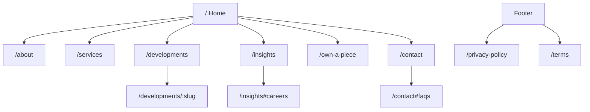

# 03 — App Flow

**Last updated:** 2026-11-17

## 1. Sitemap



Unknown paths and unknown development slugs render the 404 page. In production every known route is a prerendered HTML file, and anything else is served `404.html` with an HTTP 404 status (see [02-TRD.md](02-TRD.md) §2a). For crawlers, `/sitemap.xml` lists every route above except the 404 (one URL per development), and `/robots.txt` points to it. Query-string state (`/contact?type=…`, `/developments?category=…`) is applied right after the page hydrates. Paths are case-sensitive (`/About` is a 404). On the 404 page no header section is marked as current.

## 2. Navigation

**Header (desktop):** Logo → `/` · About ▾ · Services · Developments ▾ · Insights · Own a Piece · **Get In Touch** (button → `/contact`)

| Dropdown | Items |
|----------|-------|
| About ▾ | Company Overview `#overview` · Vision & Mission `#vision` · Advisory Board `#board` · The Team `#team` · Project Categories `#categories` · Partnerships `#partnerships` |
| Developments ▾ | Residential · Commercial · Land (each opens `/developments?category=…`) |

**Header (mobile, < 1024 px):** logo + menu button → full-height sheet with all links and sub-links; closes on navigation or Escape.

**Footer:** page links · FAQs (`/contact#faqs`) · Careers at Hilltop (`/insights#careers`) · Privacy Policy · Terms & Conditions · contact details · WhatsApp.

## 3. Pages and sections

| Route | Sections (in order) |
|-------|---------------------|
| `/` | Hero ("Building Sustainable Cities for Generations") · The Future of Cities Starts with Us · Creating Spaces That Move Life Forward (Residential / Commercial / Land) · Expertise That Moves Developments Forward (7 services) · Upcoming Developments (5) · As the Future Unfolds (CTA) |
| `/about` | Who We Are `#overview` · Vision & Mission `#vision` · Advisory Board `#board` · Our Team `#team` · Project Categories `#categories` (Metropolis / Countryside / Hinterland) · Building with Tomorrow in Mind `#tomorrow` · Partnerships `#partnerships` · Be Part of What Comes Next `#next` (CTA) |
| `/services` | Page hero · 10 services · Our Valued Clients · Let's Bring Your Next Project to Life (CTA) |
| `/developments` | Page hero · Category filter (All / Residential / Commercial / Land) · Development grid · CTA |
| `/developments/:slug` | Back link · Title + summary · Fact cards · Image gallery · Overview · Register interest CTA · Other developments |
| `/insights` | Page hero · News & Updates `#news` · Articles `#articles` · Careers at Hilltop `#careers` (News/Articles buttons open a WhatsApp "add me to updates" message until posts exist; Careers → `/contact?type=careers`) |
| `/contact` | Get in Touch (contact information + enquiry form) · FAQ (11) |
| `/own-a-piece` | Hero ("Own a Piece of the Earth.") · Land / Estate / Property / Investment opportunities · Interested in an Opportunity? (CTA) |
| `/privacy-policy`, `/terms` | Placeholder text until legal copy is supplied |

## 4. Key user flows

### 4.1 Register interest in a development

```mermaid
sequenceDiagram
  actor V as Visitor
  V->>Home: Lands on /
  Home->>Developments: "Explore Our Projects"
  Developments->>Detail: Clicks "Goshen by Hilltop"
  Detail->>Contact: "Register interest" → /contact?type=development&development=goshen
  Contact->>Contact: Form pre-filled with enquiry type + development
  V->>Contact: Fills name, email, message; submits
  Contact->>EmailApp: Opens pre-filled email to info@hilltopdevelopments.com
```

### 4.2 Partnership proposal

About → Partnerships → "Partner with Hilltop" → `/contact?type=partnership` → form opens with "Partnership" selected → submit (email) or "Send on WhatsApp".

### 4.3 Ownership enquiry

`/own-a-piece` → choose an opportunity card → "Enquire" → `/contact?type=ownership&opportunity=land` → submit.

### 4.4 Answer a question without contacting

Footer "FAQs" → `/contact#faqs` → page scrolls to the FAQ → expand a question → "Still have questions? Get in touch" scrolls to the form.

## 5. Query parameters accepted by `/contact`

| Param | Values | Effect |
|-------|--------|--------|
| `type` | `development`, `services`, `partnership`, `ownership`, `careers`, `general` | Pre-selects the enquiry type |
| `development` | any development slug | Pre-selects the development |
| `opportunity` | `land`, `estate`, `property`, `investment` | Adds the opportunity to the message subject |

Unknown values are ignored and fall back to `general`.
