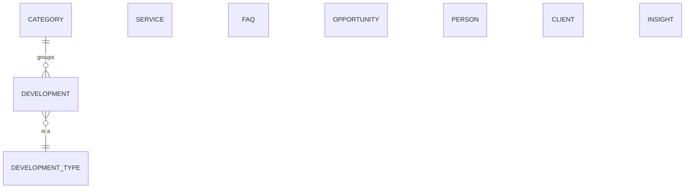

# 05 — Backend Schema

**Last updated:** 2026-11-17

## 1. Current state

**There is no backend or database.** The site is a static single-page app. Content lives in JavaScript modules under `src/data/`, and enquiries are handed to the visitor's email app or WhatsApp. This document defines those content models so they can move to a CMS or database later without changing the UI.

## 2. Content models (`src/data/`)

### `developments.js` → `Development`

| Field | Type | Example | Notes |
|-------|------|---------|-------|
| `slug` | string (unique, kebab-case) | `goshen` | Used in `/developments/:slug` |
| `name` | string | `Goshen by Hilltop` | |
| `type` | `'residential' \| 'commercial' \| 'land'` | `residential` | Drives the filter |
| `status` | `'coming-soon' \| 'selling' \| 'completed'` | `coming-soon` | All are `coming-soon` today |
| `tagline` | string | `Luxury residential` | Short label on cards |
| `summary` | string | copy-doc paragraph | Card + detail intro |
| `audience` | string | `Buyers seeking privacy and refined living` | Fact card |
| `image` | string (path in `public/`) | `/images/goshen-residence.jpg` | Card image |
| `gallery` | string[] | two paths | Detail page |
| `imageAlt` | string | | Accessible description |

### `services.js` → `Service`

| Field | Type | Notes |
|-------|------|-------|
| `id` | string | e.g. `design-build` |
| `title` | string | |
| `description` | string | Copy-doc text |
| `icon` | string | lucide icon name |
| `featuredOnHome` | boolean | First 7 services appear on Home |
| `image` | string \| undefined | Bento image cards |

### `faqs.js` → `Faq` — `{ question: string, answer: string }` (11 items).

### `opportunities.js` → `Opportunity` — `{ id: 'land'|'estate'|'property'|'investment', title, description, image, imageAlt }`.

### `categories.js` → `ProjectCategory` — `{ id: 'metropolis'|'countryside'|'hinterland', name, description, image, imageAlt }`.

### `people.js`

| Export | Shape | Current value |
|--------|-------|---------------|
| `team` | `Person[]` | `[]` (awaiting client content) |
| `clients` | `{ name: string, logo: string }[]` | `[]` |

`src/data/partners.js` exports `PARTNERS`: `{ name, logo: string \| null, width?, height? }[]` (five entries, all with logos; `logo: null` would render a text wordmark). A development may carry an optional `flyer: { src, alt, width, height }` (Goshen and Splurge), and each service has `image`, `imageAlt` and an optional `imagePosition`.

`Person` = `{ name: string, title: string, bio: string, photo: string }`.

### `site.js`

Site name, tagline, URLs, contact details (`email`, `phone`, `phoneHref`, `whatsapp`, `address`), header navigation tree, footer links.

## 3. Enquiry payload (client-side today)

Built and validated in `src/lib/enquiry.js`.

| Field | Type | Rules |
|-------|------|-------|
| `name` | string | Required, 2–80 chars |
| `email` | string | Required, valid email |
| `phone` | string | Optional; 7–15 digits (E.164), up to 25 characters including spaces, `+ ( ) -` |
| `type` | enum | `development`, `services`, `partnership`, `ownership`, `careers`, `news`, `articles`, `general` |
| `development` | string | Optional, must be a known slug |
| `message` | string | Required, 10–2000 chars |

`buildMailto(payload)` → `mailto:info@hilltopdevelopments.com?subject=…&body=…`
`buildWhatsAppLink(payload)` → `https://wa.me/2349139083794?text=…`

## 4. Planned API (not built)

When a server is added (Vercel Function + Resend, or Formspree):

| Method | Path | Body | Response |
|--------|------|------|----------|
| `POST` | `/api/enquiries` | Enquiry payload (§3) | `{ success: true, data: { id }, error: null }` or `{ success: false, data: null, error: "message" }` |

Requirements for that endpoint: server-side re-validation with the same schema, rate limit (e.g. 5 per IP per 10 min), honeypot field, API key in Vercel environment variables, no PII in logs.
